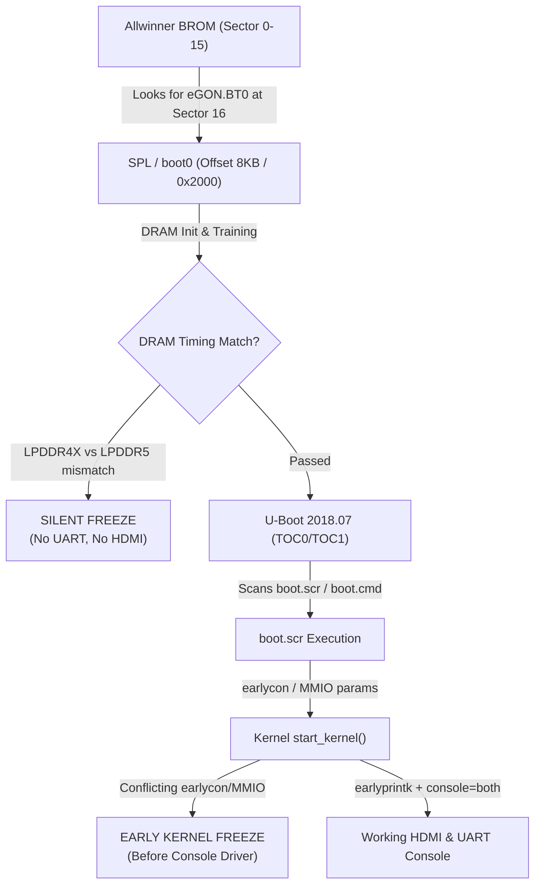

# Allwinner A733 Boot & Display Remediation Guide (`A733_BOOT_FIX.md`)

This document provides a comprehensive root-cause analysis and step-by-step remediation guide for non-bootable SD/eMMC images on Allwinner A733 (`sun60iw2p1`) boards (Orange Pi 4 Pro, Radxa Cubie A7A, Radxa Cubie A7S).

---

## 1. Summary of Issues & Root Causes

When transitioning kernel versions or porting images between Allwinner A733 boards, images frequently fail to show UART output, fail to initialize HDMI, or freeze during early boot.



### The 4 Major Failure Modes

| Failure Symptom | Underlying Root Cause | Technical Details |
|---|---|---|
| **Zero UART & Zero HDMI Output** | **Bootloader / SPL Incompatibility at Sector 16** | The BROM loads SPL (`eGON.BT0`) at sector 16 (offset 8,192 bytes). If an image contains LPDDR5-only training timings (Radxa vendor SPL) and is booted on LPDDR4X hardware (Orange Pi 4 Pro) or uncalibrated rails, DRAM training fails immediately. The CPU hangs before U-Boot or UART drivers initialize. |
| **Silent Freeze in Early Kernel Boot** | **Conflicting `earlycon` / MMIO Settings** | Passing `earlycon=uart8250,mmio32,0x02500000` causes an immediate hang on Allwinner 6.18 mainline prior to MMU page table setup. Setting `earlycon=on` or using `earlyprintk=sunxi-uart,0x02500000` is required. |
| **No HDMI Output (UART works)** | **Display Engine Blender Channel & Force Timings** | In Allwinner DE355, setting `&de { chn_cfg_mode = <0>; }` leaves blender channel count at 0, preventing video stream multiplexing. Furthermore, missing `force-output` and `force-output-timing` in `&hdmi0` causes driver probe failure when EDID read from the monitor is delayed. |
| **Root Partition Not Found / Boot Loop** | **Device Path & Discovery Failure in Initramfs** | Mainline kernels identify SD card blocks as `/dev/mmcblk0p1` or `/dev/mmcblk1p1` depending on probe order. Hardcoded PARTUUIDs that do not match the image's disk identifier leave initramfs unable to mount `/`. |

---

## 2. Bootloader Architecture (Sector 16 / Offset 8192)

Allwinner A733 SoCs require the initial boot stage (SPL `boot0`) and U-Boot package to be placed in raw unpartitioned space starting at **Sector 16** (8,192 bytes):

```text
Sector 0 (Offset 0):            MBR Partition Table (0x55AA signature)
Sectors 1..15 (Offset 512):     Reserved Space
Sector 16 (Offset 8,192):       eGON.BT0 SPL Header & DRAM Init Code
Sectors 16..35136:              TOC0 / TOC1 / ATF / U-Boot 2018.07 Package (17.15 MB)
Sector 65536 (Offset 32 MB):    Start of Partition 1 (Rootfs /boot)
```

### Flashing the Universal Working Bootloader
To ensure cross-board boot compatibility across Orange Pi 4 Pro and Radxa Cubie boards:
```bash
# Decompress and flash verified bootloader binary:
dd if=bootloader-orangepi-4-pro.bin of=/dev/sdX bs=512 seek=16 conv=notrunc status=progress
sync
```

---

## 3. Dual Console Configuration (UART0 & HDMI)

To ensure visible boot diagnostics and a usable shell on both the serial debug port and the HDMI monitor simultaneously, configure the U-Boot environment and Linux command line arguments.

### UART Pinout Reference (40-Pin Header)
On both Orange Pi 4 Pro and Radxa Cubie A7A/A7S, UART0 is routed to the standard 40-pin header:
- **Pin 6 / Pin 9**: GND
- **Pin 8**: `UART0_TX` (PB9) -> Connect to USB-UART Adapter RX
- **Pin 10**: `UART0_RX` (PB10) -> Connect to USB-UART Adapter TX
- **Baud Rate**: `115200`, 8 data bits, no parity, 1 stop bit

### Required Environment Settings (`orangepiEnv.txt` & `radxaEnv.txt`)
Place this configuration in `/boot/orangepiEnv.txt` and `/boot/radxaEnv.txt`:

```ini
verbosity=7
bootlogo=false
console=both
earlycon=on
overlay_prefix=sun60i-a733
fdtfile=allwinner/sun60i-a733-orangepi-4-pro.dtb
rootdev=/dev/mmcblk0p1
rootfstype=ext4
extraargs=cma=256M
```

### U-Boot Command Script (`boot.cmd`) Console Logic
The `boot.cmd` script processes `console=both` by configuring both devices:

```text
# Dual console handling in boot.cmd
if test "${console}" = "display"; then setenv consoleargs "console=tty1"; fi
if test "${console}" = "serial"; then setenv consoleargs "console=ttyS0,115200"; fi
if test "${console}" = "both"; then setenv consoleargs "console=tty1 console=ttyS0,115200"; fi

if test "${earlycon}" = "on"; then setenv consoleargs "earlyprintk=sunxi-uart,0x02500000 ${consoleargs}"; fi
```

Recompile into binary `boot.scr`:
```bash
mkimage -C none -A arm64 -T script -d /boot/boot.cmd /boot/boot.scr
```

---

## 4. HDMI Output & Device Tree Configuration

To ensure HDMI output initializes reliably on Linux 6.18 mainline:

### 1. Display Engine Blender Mode (`&de`)
In the board device tree (`sun60i-a733-orangepi-4-pro.dts` or `sun60i-a733-cubie-a7a.dts`):
```dts
&de {
    assigned-clock-rates = <600000000>;
    chn_cfg_mode = <2>;   /* REQUIRED: Mode 2 maps video & UI blender channels */
    status = "okay";
};
```

### 2. HDMI Display & Physical Timings (`&hdmi0`)
```dts
&hdmi0 {
    status = "okay";
    dcdc2-supply = <&reg_dcdc2>;
    cldo2-supply = <&reg_cldo2>;
    hdmi_power0 = "dcdc2";
    hdmi_power1 = "cldo2";
    hdmi_power_cnt = <2>;
    hdmi_hdcp1x_enable = <1>;
    hdmi_hdcp2x_enable = <1>;
    hdmi_cec_enable = <1>;
    hdmi_clock_source = <0>;
    hdmi_resistor_select = <1>;
    hdmi_ddc_index = <20>;
    priority = <6>;
    force-output = <0>;
    force-output-timing = "440000-3440-3450-4500-4800-1440-1455-1464-1494";
};
```

### 3. Cross-Board Device Tree Fallbacks
Because U-Boot scripts query `dtb/${fdtfile}`, ensure copies of the working DTB exist for all target board names inside `/boot` and `/boot/dtb/allwinner/`:
```bash
cp /boot/sun60i-a733-orangepi-4-pro.dtb /boot/sun60i-a733-cubie-a7a.dtb
cp /boot/sun60i-a733-orangepi-4-pro.dtb /boot/sun60i-a733-cubie-a7s.dtb
cp /boot/sun60i-a733-orangepi-4-pro.dtb /boot/dtb/allwinner/sun60i-a733-orangepi-4-pro.dtb
cp /boot/sun60i-a733-orangepi-4-pro.dtb /boot/dtb/allwinner/sun60i-a733-cubie-a7a.dtb
cp /boot/sun60i-a733-orangepi-4-pro.dtb /boot/dtb/allwinner/sun60i-a733-cubie-a7s.dtb
```

---

## 5. Correct Root Paths & Initramfs Discovery

To avoid kernel panic `Cannot open root device "..."` or initramfs timeout:

1. **U-Boot `rootdev`**: Explicitly specify `rootdev=/dev/mmcblk0p1` in `radxaEnv.txt` / `orangepiEnv.txt`.
2. **Delayed Device Settling**: Include `rootdelay=1` and `rootwait` in the bootargs:
   ```text
   setenv bootargs "root=${rootdev} rootwait rootdelay=1 rootfstype=ext4 ..."
   ```
3. **Initramfs Fallback Symlink**: Ensure `/etc/initramfs-tools/scripts/local-top/discovery` provides an automatic fallback to `/dev/mmcblk0p1` if PARTUUID resolution is unavailable:
   ```bash
   if [ -b "/dev/mmcblk0p1" ]; then
       mkdir -p /dev/disk/by-uuid /dev/disk/by-partuuid
       ln -sf "/dev/mmcblk0p1" "/dev/disk/by-partuuid/$target_partuuid"
   fi
   ```
4. **`/etc/fstab` Integrity**: Ensure `/etc/fstab` mounts `/` without invalid UUID references:
   ```text
   /dev/mmcblk0p1  /  ext4  defaults,noatime,commit=600,errors=remount-ro  0  1
   ```

---

## 6. Automated Auto-Login Configuration

To enable immediate terminal access on both serial console (`ttyS0`) and HDMI screen (`tty1`) without requiring manual credential entry:

### Serial Getty Auto-login (`/etc/systemd/system/serial-getty@ttyS0.service.d/override.conf`)
```ini
[Service]
ExecStart=
ExecStart=-/sbin/agetty -o "-p -f -- \\u" --keep-baud --autologin radxa 115200,38400,9600 %I $TERM
```

### HDMI Virtual Terminal Auto-login (`/etc/systemd/system/getty@tty1.service.d/override.conf`)
```ini
[Service]
ExecStart=
ExecStart=-/sbin/agetty -o "-p -f -- \\u" --noclear --autologin radxa %I $TERM
```

*(For Orange Pi images, substitute `radxa` with `orangepi`).*

---

## 7. Quick Automated Repair with `fix-a7a-sdcard.sh`

For existing non-booting SD cards, download and run the self-contained fixup script directly against the SD card block device:

```bash
wget https://github.com/jonas5/Allwinner-A733-kernel/releases/download/radxa-cubie-a7a-releases/fix-a7a-sdcard.sh
chmod +x fix-a7a-sdcard.sh

# Flash bootloader to sector 16 and update /boot in one step:
sudo ./fix-a7a-sdcard.sh /dev/mmcblk0
```
